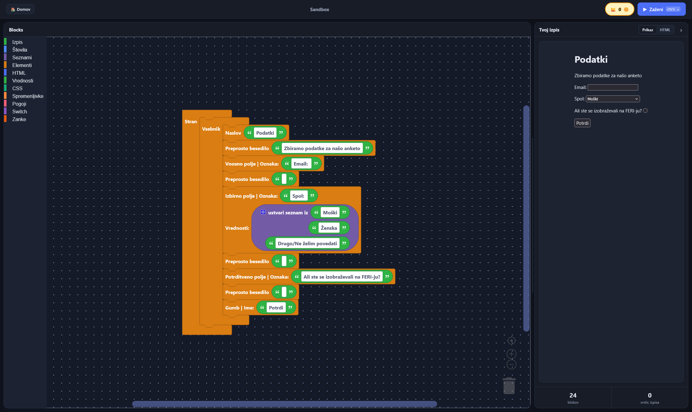

<div align="center">

# CEJO

[](https://github.com/jan5er/CEJO-RUPS)
[](https://github.com/jan5er/CEJO-RUPS/actions?query=branch%3Amain)
[](https://react.dev)
[](https://developers.google.com/blockly)
[](https://vite.dev)

</div>

Learn web programming with blocks. Snap together HTML elements, CSS and JavaScript logic in [Blockly], and see the page you built right next to the one each task asks for.



## Development

```sh
pnpm install
pnpm dev     # start the dev server
pnpm test    # run tests
pnpm lint    # Biome
```

[Blockly]: https://developers.google.com/blockly
